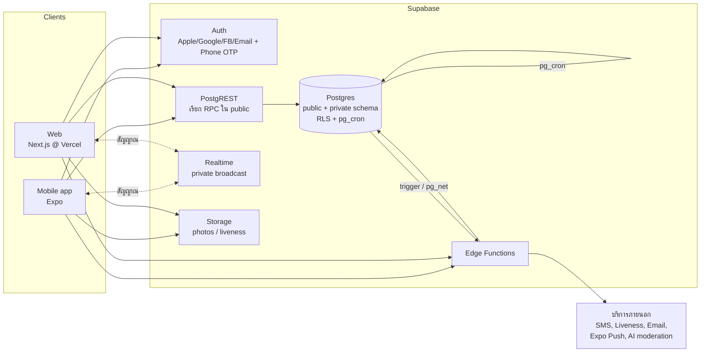
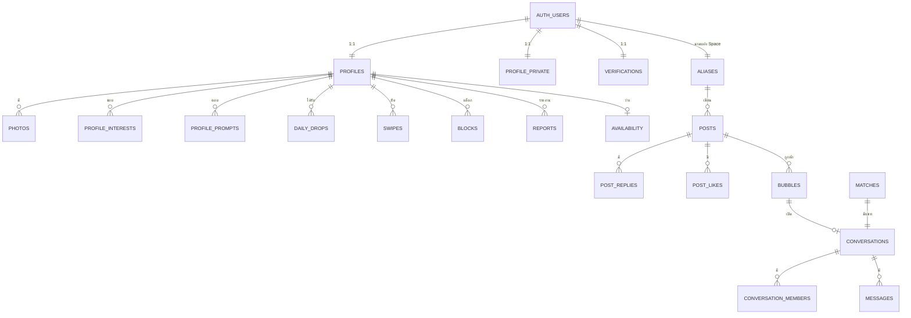
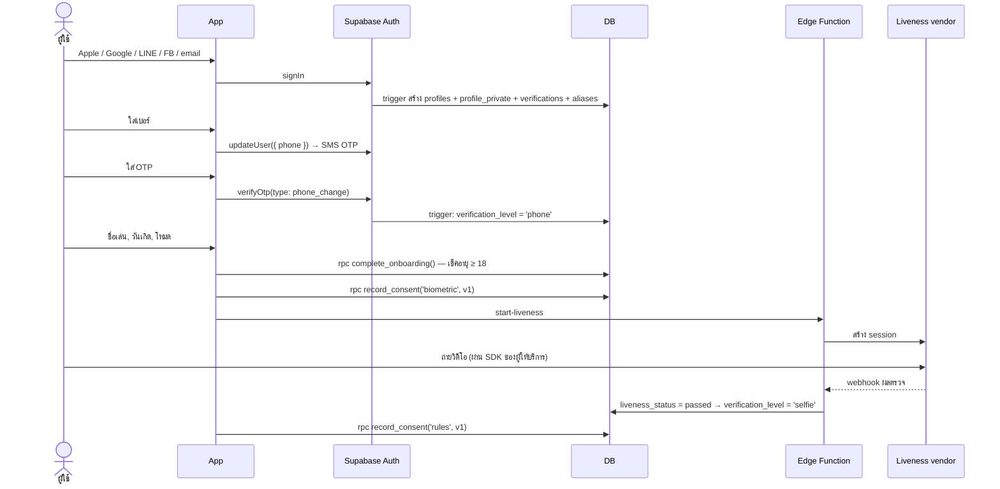
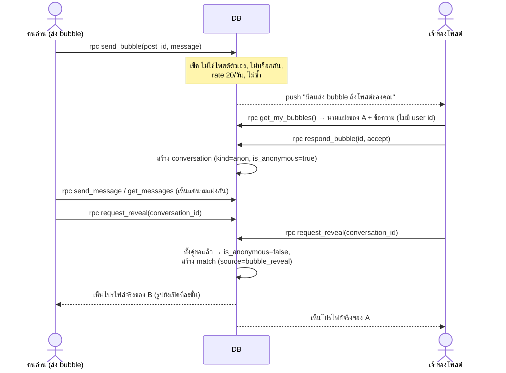

# System Design — stuMatch

> ออกแบบระบบสำหรับฟีเจอร์ใน [`PRODUCT.md`](PRODUCT.md) บน Supabase (Postgres + Auth + Storage + Realtime + Edge Functions)
> อ่าน [`ARCHITECTURE.md`](ARCHITECTURE.md) ก่อน (ภาพรวม stack) — ไฟล์นี้ลงรายละเอียด **data model, สิทธิ์, flow, งานเบื้องหลัง**
> สถานะ: **ร่างออกแบบ (2026-10-24)** ยังไม่ได้ implement — ชื่อตาราง/คอลัมน์ปรับได้ตอนเขียน migration จริง

---

## 0. สรุปการตัดสินใจหลัก (อ่านแค่นี้ก็พอเข้าใจ)

1. **RPC-first + schema `private`** — ข้อมูลอ่อนไหว (ตัวตนคนโพสต์, แชท, การปัด, วันเกิด, การยืนยันตัวตน) อยู่ใน schema `private` ที่ **API ไม่เปิด** client เข้าถึงผ่าน **Postgres function ใน `public`** เท่านั้น ซึ่งคืนเฉพาะคอลัมน์ที่ปลอดภัย
   → ป้องกัน "ไม่ระบุตัวตน" หลุดได้ในระดับ database ไม่ใช่แค่ซ่อนใน UI
2. **ไม่มี user id ใน Space เลย** — client ไม่เคยได้รับ `user_id` ของคนโพสต์/คน bubble/คู่แชทนามแฝง ได้แค่นามแฝง + `is_mine`
3. **Realtime = แค่สัญญาณ** — ใช้ Broadcast แบบ private channel ส่งแค่ "มีข้อความใหม่ใน conversation X" แล้ว client ดึงข้อมูลผ่าน RPC (ไม่ใช้ postgres_changes เพราะ payload มีทุกคอลัมน์ → ตัวตนหลุด)
4. **รูปอยู่ใน bucket private** — ดูได้ผ่าน signed URL ที่ server ออกให้ตามขั้นการเปิดรูปเท่านั้น
5. **กติกาทางธุรกิจอยู่ใน database** — match, หมดอายุ 48 ชม., ขั้นเปิดรูป, rate limit, บล็อก คำนวณใน SQL function (ตรวจสอบด้วย pgTAP) ไม่ใช่ใน client
6. **งานตามเวลาใช้ `pg_cron`** — สร้าง Daily Drop 19:00, หมดอายุ match, ลบข้อมูลตามระยะเวลา
7. **Edge Functions เฉพาะงานที่ต้องใช้ secret / บริการภายนอก** — selfie liveness, ส่งอีเมลยืนยันองค์กร, push notification, ตรวจเนื้อหาด้วย AI, ลบบัญชี, LINE login

### ⚠️ สิ่งที่ต้องแก้จากของที่มีอยู่ตอนนี้

| ของเดิม (migration แรก)                                            | ปัญหา                                                               | แก้เป็น                                                                                |
| ------------------------------------------------------------------ | ------------------------------------------------------------------- | -------------------------------------------------------------------------------------- |
| bucket `avatars` เป็น **public**                                   | ใครรู้ path (`<user id>/...`) ก็เปิดรูปได้ → ขัดกับ "รูปค่อยๆ เปิด" | bucket `photos` แบบ **private** + signed URL (หัวข้อ 7)                                |
| `profiles.avatar_url` + policy "ผู้ใช้ที่ login อ่านได้ทุกโปรไฟล์" | ใครก็ list โปรไฟล์ + รูปของทุกคนได้ (scrape ได้)                    | ปิด select ตรง, ดูโปรไฟล์ผ่าน RPC ที่เช็คว่ามีสิทธิ์เห็น (อยู่ใน Drop / match กันแล้ว) |

---

## 1. ภาพรวมส่วนประกอบ



---

## 2. Client

### Mobile (Expo) = ตัวหลัก

ทุกฟีเจอร์ใน MVP อยู่ในแอปมือถือ

### Web (Next.js) — แนะนำให้ทำ 2 อย่างก่อน

| ส่วน                                                                  | ทำไม                                            |
| --------------------------------------------------------------------- | ----------------------------------------------- |
| **หน้า landing + เอกสารกฎหมาย** (`/`, `/terms`, `/privacy`, `/rules`) | ต้องมีตอนส่งแอปขึ้น store, SEO, ลิงก์จากโซเชียล |
| **Moderation console** (`/admin`)                                     | ทีมต้องตรวจรายงานบนจอใหญ่, ใช้ role `moderator` |

ตัวแอปเต็มบนเว็บ (ปัด/แชท) ทำทีหลัง — เพราะ selfie liveness / push / แชร์ตำแหน่ง ทำบนมือถือดีกว่า → **ต้องให้ทีมยืนยัน (Q13)**

### โค้ดที่ใช้ร่วมกัน

```
packages/
├── shared/   ← (มีแล้ว) types จาก DB, zod schemas, constants
└── api/      ← (ใหม่) ฟังก์ชันเรียก Supabase แบบมี type เช่น getFeed(), swipe(), sendMessage()
                 ใช้ทั้ง web และ mobile → logic การเรียก RPC อยู่ที่เดียว
```

- Data fetching: **TanStack Query** (cache, retry, infinite scroll ของ feed)
- i18n: ข้อความทั้งหมดอยู่ในไฟล์แปล `th.json` / `en.json` (เช่น `i18next`) — ห้ามเขียนข้อความไทยตรงใน component
- Theme: token สีชุดเดียวกับดีไซน์ (`light`, `gold`) เก็บใน `packages/shared` ใช้ทั้งสองแอป

---

## 3. ส่วนของ Supabase ที่ใช้

| ความต้องการ                | ใช้อะไร                                                                                             |
| -------------------------- | --------------------------------------------------------------------------------------------------- |
| สมัคร / login              | Supabase Auth: Apple, Google, Facebook, email · LINE ผ่าน custom OIDC หรือ Edge Function (ต้องเช็ค) |
| ยืนยันเบอร์                | Supabase Auth phone (`updateUser({ phone })` + `verifyOtp`) → เบอร์อยู่ใน `auth.users`, ซ้ำไม่ได้   |
| ข้อมูล + สิทธิ์            | Postgres + RLS + RPC (security definer)                                                             |
| เวลาตามรอบ                 | `pg_cron`                                                                                           |
| เรียก Edge Function จาก DB | `pg_net` (จาก trigger) หรือ Database Webhooks                                                       |
| แชทสด / แจ้งว่ามีอะไรใหม่  | Realtime **Broadcast** + private channel (RLS บน `realtime.messages`)                               |
| รูป / วิดีโอ selfie        | Storage (bucket private) + signed URL                                                               |
| ระยะทาง (ว่างตอนนี้)       | PostGIS (เปิด extension) — เก็บพิกัดแบบหยาบเท่านั้น                                                 |
| ความลับ (API key ภายนอก)   | Edge Function secrets (`supabase secrets set`)                                                      |

---

## 4. โมเดลความปลอดภัยของข้อมูล

### 4.1 สอง schema

| schema    | API เปิด? | มีอะไร                                                            | client เข้าถึงยังไง                            |
| --------- | --------- | ----------------------------------------------------------------- | ---------------------------------------------- |
| `public`  | ✅        | ตารางที่ไม่อ่อนไหว (เช่น `areas`, `interests`), **RPC functions** | `supabase.from()` (ตาม RLS) / `supabase.rpc()` |
| `private` | ❌        | ตัวตนคนโพสต์, แชท, การปัด, match, การยืนยันตัวตน, รายงาน          | **ผ่าน RPC เท่านั้น**                          |

> Supabase เปิด API เฉพาะ schema ที่ตั้งไว้ใน API settings (ค่าเริ่มต้น `public`) → ตารางใน `private` ไม่มี REST endpoint เลย
> ยังต้อง **enable RLS ทุกตารางใน `private` ด้วย** (กันพลาดถ้าวันหนึ่งมีคนเปิด schema)

### 4.2 กติกาการเขียน RPC (สำคัญมาก)

```sql
create function public.xxx(...)
returns ...
language plpgsql
security definer          -- อ่าน/เขียน private ได้
set search_path = ''      -- กัน search_path hijack
as $$
begin
  perform private.assert_active_user();   -- 1) ต้อง login + ยืนยันแล้ว + ไม่ถูกแบน
  -- 2) เช็คสิทธิ์กับ row ที่จะแตะ (เป็นสมาชิก conversation? อยู่ใน drop วันนี้?)
  -- 3) เช็ค rate limit
  -- 4) ทำงาน + คืนเฉพาะคอลัมน์ที่ปลอดภัย (ห้ามคืน user_id ใน Space/แชทนามแฝง)
end;
$$;
revoke execute on function public.xxx from public, anon;
grant execute on function public.xxx to authenticated;
```

### 4.3 Helper functions (`private`)

| function                            | คืนค่า           | ใช้ทำอะไร                                                       |
| ----------------------------------- | ---------------- | --------------------------------------------------------------- |
| `uid()`                             | `auth.uid()`     | ย่อ                                                             |
| `assert_active_user()`              | error ถ้าไม่ผ่าน | login แล้ว + `verification_level >= 'selfie'` + ไม่ถูกระงับ/แบน |
| `is_blocked(a, b)`                  | boolean          | บล็อกกันทางใดทางหนึ่ง → ห้ามเห็นกันทุกที่                       |
| `check_rate(action, limit, window)` | error ถ้าเกิน    | นับจาก `private.rate_events`                                    |
| `age(birthdate)`                    | int              | อายุจากวันเกิด (ไม่ส่งวันเกิดออกไป)                             |
| `is_moderator()`                    | boolean          | `auth.jwt() -> 'app_metadata' ->> 'role' = 'moderator'`         |

---

## 5. Data model

### 5.1 ภาพรวมความสัมพันธ์



### 5.2 ผู้ใช้ + ตัวตน

**`public.profiles`** (มีแล้ว — ต้องปรับ) — ข้อมูลที่ "คนที่มีสิทธิ์เห็น" เห็นได้

| คอลัมน์              | ชนิด                     | หมายเหตุ                                                      |
| -------------------- | ------------------------ | ------------------------------------------------------------- |
| `id`                 | uuid PK → `auth.users`   |                                                               |
| `display_name`       | text (1–50)              | ชื่อเล่น                                                      |
| `bio`                | text (≤500)              |                                                               |
| `occupation`         | text                     | "UX Designer", "นักศึกษาปี 3" (ผู้ใช้พิมพ์เอง)                |
| `area_id`            | int → `areas`            | ย่าน (ไม่ใช่พิกัด)                                            |
| `modes`              | text[]                   | `{'friend','date'}`                                           |
| `org_badge`          | text null                | "มหาวิทยาลัย…" / ชื่อบริษัท — **เขียนได้เฉพาะ Edge Function** |
| `verification_level` | enum `none/phone/selfie` | **เขียนได้เฉพาะ server**                                      |
| `locale`, `theme`    | text                     | ตั้งค่า (ซิงก์ข้ามเครื่อง)                                    |
| `last_active_at`     | timestamptz              | ใช้คัด Drop (ไม่แสดงให้คนอื่น)                                |
| ~~`avatar_url`~~     |                          | **ลบ** → ใช้ `photos`                                         |

RLS: เจ้าของ select/update คอลัมน์ของตัวเอง (ยกเว้น `org_badge`, `verification_level` ใช้ column privilege / trigger กันแก้) · คนอื่น **ไม่มี select ตรง** → ดูผ่าน `get_profile_card(user_id)` ที่เช็คสิทธิ์ก่อน

**`private.profile_private`** — `user_id`, `birthdate` (แก้ไม่ได้หลังตั้ง), `gender` (null ได้), `interested_in` (สำหรับโหมดเดท, null ได้), `age_min`, `age_max`, `max_distance_km`

**`private.verifications`** — `user_id`, `phone_verified_at`, `liveness_status` (`pending/passed/failed`), `liveness_passed_at`, `liveness_vendor_ref`, `liveness_face_hash` (สำหรับกันคนที่ถูกแบนสมัครใหม่ ถ้าผู้ให้บริการรองรับ — **ต้องเช็คกับทนายเรื่อง PDPA**), `org_type`, `org_domain`, `org_verified_at`

**`private.aliases`** — นามแฝงใน Space: `user_id` (unique), `alias` (unique, สุ่มจากคลังคำ เช่น ส้มโอ, กาแฟเย็น), `color`, `created_at`

- เปลี่ยนนามแฝงได้ (เช่น เดือนละครั้ง) → โพสต์เก่ายังแสดงนามแฝงเดิม (เก็บ `alias` snapshot ในโพสต์)

**`public.photos`** — `id`, `user_id`, `storage_path`, `position` (0–5), `moderation_status`, `created_at` · RLS: เจ้าของจัดการของตัวเอง, คนอื่นไม่มี select (ดูผ่าน signed URL จาก RPC)

**`public.interests`** (รายการแท็กกลาง เช่น ตีแบด, คาเฟ่) + **`public.profile_interests`** (`user_id`, `interest_id`) · **`public.prompts`** (คลังคำถาม) + **`public.profile_prompts`** (`user_id`, `prompt_id`, `answer`)

**`public.areas`** — ย่านที่เลือกได้ (`id`, `name_th`, `name_en`, `city`, `centroid geography`) อ่านได้ทุกคน

**`private.consents`** — `user_id`, `doc` (`terms/privacy/rules/biometric/location`), `version`, `accepted_at`, `withdrawn_at`

### 5.3 Space (ไม่ระบุตัวตน)

**`private.posts`**

| คอลัมน์                       | หมายเหตุ                                                                                 |
| ----------------------------- | ---------------------------------------------------------------------------------------- |
| `id` uuid                     |                                                                                          |
| `author_id` uuid → auth.users | **ไม่มีวันออกไปถึง client**                                                              |
| `alias`, `alias_color`        | snapshot นามแฝงตอนโพสต์                                                                  |
| `body` text (1–500)           |                                                                                          |
| `area_id`, `age_band`         | snapshot ตอนโพสต์ สำหรับแท็บ ใกล้ฉัน / วัยเดียวกัน (age_band = ช่วง 18–21, 22–25, 26–30) |
| `mood`                        | null ได้                                                                                 |
| `status`                      | `pending / published / hidden / removed`                                                 |
| `like_count`, `reply_count`   | อัปเดตด้วย trigger                                                                       |
| `created_at`                  |                                                                                          |

**`private.post_replies`** — เหมือน posts แต่มี `post_id` (ตอบกลับก็ไม่ระบุตัวตน, แสดงนามแฝงของผู้ตอบ + ป้าย "เจ้าของโพสต์" ถ้าเป็นคนเดียวกัน)

**`private.post_likes`** — (`post_id`, `user_id`) PK คู่

**`private.mood_checkins`** — `user_id`, `mood`, `date` (unique ต่อวัน) — ใช้จัดอันดับ feed เท่านั้น ไม่แสดงให้ใคร

**`private.bubbles`** — การทักเจ้าของโพสต์

| คอลัมน์                      | หมายเหตุ                                  |
| ---------------------------- | ----------------------------------------- |
| `id`, `post_id`              |                                           |
| `sender_id`, `recipient_id`  | recipient = author ของโพสต์ (ไม่ส่งออก)   |
| `message`                    | ข้อความแรก (≤200)                         |
| `status`                     | `pending / accepted / declined / expired` |
| `conversation_id`            | เมื่อ accepted                            |
| `created_at`, `responded_at` |                                           |

unique (`post_id`, `sender_id`) — ทักโพสต์เดียวได้ครั้งเดียว

### 5.4 Match

**`private.daily_drops`** — `user_id`, `drop_date`, `mode`, `candidate_id`, `rank`, `score`, `action` (`null/like/skip`), `acted_at` · unique (`user_id`, `drop_date`, `mode`, `candidate_id`)

**`private.swipes`** — `swiper_id`, `target_id`, `mode`, `direction` (`like/skip`), `created_at` · PK (`swiper_id`, `target_id`, `mode`) — ใช้เช็ค "เขาชอบเรามาก่อนไหม" และไม่เอาคนที่เคยปัดแล้วมาโชว์ซ้ำ

**`private.matches`**

| คอลัมน์                      | หมายเหตุ                                                   |
| ---------------------------- | ---------------------------------------------------------- |
| `id`                         |                                                            |
| `user_a`, `user_b`           | เก็บแบบเรียง (`user_a < user_b`) + unique คู่ต่อโหมด       |
| `mode`                       | `friend / date`                                            |
| `source`                     | `drop / bubble_reveal / now`                               |
| `status`                     | `active / expired / closed / unmatched`                    |
| `expires_at`                 | `created_at + 48 ชม.` → ถูกล้างเป็น null เมื่อมีข้อความแรก |
| `closed_by`, `closed_reason` | ปุ่มจบอย่างสุภาพ / unmatch                                 |
| `conversation_id`            |                                                            |

### 5.5 แชท (ใช้ร่วมกันทุกแบบ)

**`private.conversations`** — `id`, `kind` (`match / anon / meetup`), `match_id`, `bubble_id`, `reveal_stage` (0–3), `is_anonymous` (true จนกว่าทั้งคู่กดเปิดตัว), `last_message_at`, `closed_at`

**`private.conversation_members`** — `conversation_id`, `user_id`, `alias` (สำหรับ anon), `message_count`, `last_read_at`, `wants_reveal` (สำหรับ anon), `muted`

**`private.messages`** — `id`, `conversation_id`, `sender_id` (**ไม่ส่งออก**), `body` (≤1000), `kind` (`text / system / polite_close`), `created_at`, `deleted_at`

### 5.6 ว่างตอนนี้ (หลัง MVP)

**`private.availability`** — `user_id` PK, `activity`, `until`, `area_id`, `approx_point geography` (ปัดพิกัดให้หยาบ ~500 ม. ก่อนเก็บ), `created_at` · ลบอัตโนมัติเมื่อเลย `until`

**`private.join_requests`** — `availability_user_id`, `requester_id`, `status`, `conversation_id`

### 5.7 ความปลอดภัย + ดูแลชุมชน

| ตาราง                          | คอลัมน์หลัก                                                                                                                                                                                                                   |
| ------------------------------ | ----------------------------------------------------------------------------------------------------------------------------------------------------------------------------------------------------------------------------- |
| `private.blocks`               | `blocker_id`, `blocked_id`, `created_at` (PK คู่)                                                                                                                                                                             |
| `private.reports`              | `id`, `reporter_id`, `target_type` (`post/reply/message/profile/conversation`), `target_id`, `target_user_id` (ระบบเติมให้), `reason`, `details`, `status` (`open/reviewing/actioned/dismissed`), `assigned_to`, `created_at` |
| `private.moderation_actions`   | `id`, `user_id`, `action` (`warn/hide_content/suspend/ban/unban`), `level` (1–4), `reason`, `until`, `report_id`, `moderator_id`, `created_at`                                                                                |
| `private.user_status`          | `user_id` PK, `state` (`active/suspended/banned`), `until` — อ่านใน `assert_active_user()`                                                                                                                                    |
| `private.identity_reveals_log` | ทุกครั้งที่ moderator เปิดดูตัวตนคนโพสต์ใน Space: `moderator_id`, `post_id`, `reason`, `at` (ตาม POLICY.md 6.2)                                                                                                               |
| `private.rate_events`          | `user_id`, `action`, `at` (ลบอัตโนมัติหลัง 1 วัน)                                                                                                                                                                             |
| `public.push_tokens`           | `user_id`, `expo_token`, `platform`, `updated_at` · RLS: เจ้าของจัดการของตัวเอง                                                                                                                                               |
| `private.notification_prefs`   | เปิด/ปิดแจ้งเตือนแต่ละประเภท                                                                                                                                                                                                  |

---

## 6. Flow หลัก

### 6.1 สมัคร + ยืนยันตัวตน



### 6.2 Space: โพสต์ + feed

- `create_post(body, mood?)`
  1. `assert_active_user()` + `check_rate('post', 5, '1 hour')`
  2. ตรวจเบื้องต้นใน SQL: ห้ามเบอร์โทร / LINE ID / URL / อีเมล (regex) → ถ้าเจอ ตอบ error ให้แก้
  3. insert `status = 'published'` (หรือ `'pending'` ถ้าคำต้องสงสัย) พร้อม snapshot `alias`, `area_id`, `age_band`
  4. trigger → `pg_net` เรียก Edge Function `moderate-content` (AI) แบบไม่รอ → ถ้าผิดกติกา ตั้ง `hidden` + สร้าง report อัตโนมัติ
- `get_feed(tab, cursor)` → คืน `id, alias, alias_color, body, mood, like_count, reply_count, liked_by_me, is_mine, created_at`
  - `nearby`: `area_id` เดียวกัน / ย่านติดกัน · `same_age`: `age_band` เดียวกัน · `all`
  - ตัดโพสต์ของคนที่บล็อกกัน, `status = 'published'`, ใหม่สุดก่อน (ภายหลังเพิ่มการจัดอันดับ)
  - pagination แบบ cursor (`created_at`, `id`) ไม่ใช้ offset
- `like_post`, `unlike_post`, `reply_post`, `get_replies(post_id)`, `delete_my_post`

### 6.3 Bubble → แชทนามแฝง → เปิดตัว



- เปิดตัวต้อง **ทั้งสองฝ่าย** กด ฝ่ายเดียวกดไม่มีผล (อีกฝ่ายเห็นแค่ "อีกคนอยากเปิดตัว")
- แชทนามแฝงที่ไม่มีข้อความ 7 วัน → ปิดอัตโนมัติ

### 6.4 Daily Drop + ปัด + match

**สร้าง Drop** — `pg_cron` ทุกวัน **18:50 เวลาไทย** (`50 11 * * *` UTC) เรียก `private.generate_daily_drops()`:

```
สำหรับผู้ใช้ U ที่ active ใน 14 วัน และยืนยัน selfie แล้ว, แต่ละโหมดที่ U เปิด:
  candidates = ผู้ใช้ที่
    - ยืนยัน selfie แล้ว, active ใน 7 วัน, ไม่ถูกระงับ
    - เปิดโหมดเดียวกัน (โหมดเดท: ตรงกับ gender/interested_in ของทั้งสองฝ่าย)
    - อายุอยู่ในช่วงที่ทั้งสองฝ่ายตั้งไว้
    - อยู่ในระยะ max_distance (เทียบ centroid ของ area)
    - ไม่บล็อกกัน, ไม่เคยปัดกันในโหมดนี้, ยังไม่ match กัน
  score = 3 × (เขาชอบ U มาแล้ว)            ← ให้มีโอกาส match
        + 1 × จำนวนแท็กความชอบที่ตรงกัน
        + 0.5 × (ย่านเดียวกัน)
        + 0.5 × (active ใน 24 ชม.)
        + สุ่มเล็กน้อย (ไม่ให้เห็นคนซ้ำเดิมตลอด)
  เลือก top 5 → insert daily_drops
```

- จำกัดว่าคนหนึ่งจะไปโผล่ใน Drop ของคนอื่นได้ไม่เกิน N ครั้ง/วัน (กันคนดังได้ match ไปหมด)
- 19:00 → Edge Function `send-push` แจ้ง "Drop คืนนี้มาแล้ว"
- ช่วงแรกคนน้อย: ถ้า candidates < 3 ให้ขยายระยะ/ช่วงอายุอัตโนมัติ

**ปัด** — `swipe(candidate_id, mode, direction)`:

1. ต้องมี `candidate_id` อยู่ใน `daily_drops` ของ U วันนี้ (**ปัดได้เฉพาะคนใน Drop** → scrape ไม่ได้)
2. upsert `swipes`, update `daily_drops.action`
3. ถ้า `like` และอีกฝ่าย `like` เราแล้ว → สร้าง `matches` + `conversations` ใน transaction เดียว → คืน `{ matched: true, match_id }` ให้แอปโชว์ป๊อปอัป Match
4. push ถึงอีกฝ่าย "คุณมี match ใหม่"

**ดูการ์ดใน Drop** — `get_my_drop(mode)` → `candidate_id`, ชื่อเล่น, อายุ, occupation, area name, org_badge, prompt + คำตอบ, interests, `photo_stage = 0` (ยังไม่เห็นรูป)

### 6.5 แชท + เปิดรูปทีละขั้น

`send_message(conversation_id, body)`:

1. เป็นสมาชิก, conversation ไม่ถูกปิด, ไม่บล็อกกัน, `check_rate('message', 30, '1 minute')`
2. ตรวจคำเสี่ยงกลโกง (โอนเงิน, ลงทุน, crypto, ยืมเงิน) → ติด flag ให้ฝั่งผู้รับเห็นคำเตือน
3. insert message, `message_count + 1`, `last_message_at`
4. ถ้าเป็นข้อความแรกของ match → `expires_at = null`
5. คำนวณ `reveal_stage` ใหม่:

| stage | เงื่อนไข (ทั้งสองฝ่าย)                             | เห็นอะไร                  |
| ----- | -------------------------------------------------- | ------------------------- |
| 0     | เพิ่ง match                                        | ไม่มีรูป (การ์ด + ข้อมูล) |
| 1     | ต่างคนต่างส่ง ≥ 5 ข้อความ                          | รูปที่ 1                  |
| 2     | ต่างคนต่างส่ง ≥ 15                                 | รูปที่ 1–3                |
| 3     | ต่างคนต่างส่ง ≥ 30 หรือ ทั้งคู่กด "เปิดรูปทั้งหมด" | ทุกรูป                    |

> นับ "ต่างคนต่างส่ง" ไม่ใช่รวม → คนเดียวพิมพ์รัวๆ เพื่อดูรูปไม่ได้

6. `realtime.send(...)` ไปที่ channel `conversation:<id>` (private) payload แค่ `{ conversation_id, message_id }`
7. ถ้าผู้รับไม่ได้เปิดแอป → `pg_net` → Edge Function `send-push`

`get_messages(conversation_id, before?)` → `id, body, kind, is_mine, created_at, scam_warning`
`get_conversation(conversation_id)` → ข้อมูลคู่สนทนา (นามแฝง หรือ โปรไฟล์จริง ตาม `is_anonymous`), `reveal_stage`, ข้อความที่ต้องส่งอีกกี่ข้อความถึงขั้นถัดไป

**Realtime authorization** — policy บน `realtime.messages`: subscribe channel `conversation:<id>` ได้เฉพาะสมาชิกของ conversation นั้น

### 6.6 หมดอายุ + จบอย่างสุภาพ

- `pg_cron` ทุก 15 นาที: `matches` ที่ `status = active` และ `expires_at < now()` → `expired`, ปิด conversation
- `polite_close(match_id, template_id)` → ส่งข้อความ `kind = polite_close` ("ขอบคุณที่คุยกันนะ ขอให้เจอคนที่ใช่") แล้วปิด — อีกฝ่ายไม่ได้รับแจ้งเตือนแบบสะดุ้ง
- `unmatch(match_id)` → ปิดเงียบๆ + ลบออกจากรายการของทั้งคู่

### 6.7 บล็อก + รายงาน + ดูแลชุมชน

- `block_user_from(target_type, target_id)` — รับ post/reply/message/profile แล้ว **server หา user id เอง** (client ไม่ต้องรู้ว่าเป็นใคร) → insert `blocks`, ปิด conversation/match ที่มีร่วมกัน, ซ่อนโพสต์ของกันและกัน
- `report(target_type, target_id, reason, details)` — server เติม `target_user_id`, rate 10/วัน, ระดับร้ายแรง (`minor`, `threat`, `scam`) → แจ้ง moderator ทันที
- **Moderation console (web `/admin`)** — RPC ที่เช็ค `is_moderator()`: `mod_list_reports`, `mod_get_report` (เห็นเนื้อหา + ประวัติผู้ใช้), `mod_reveal_author` (บันทึก log ทุกครั้ง), `mod_take_action` (warn/hide/suspend/ban → เขียน `moderation_actions` + `user_status`)
- ผู้ใช้เห็นผลการลงโทษของตัวเอง + ยื่นอุทธรณ์ได้ (`appeal(action_id, text)`)

### 6.8 ลบบัญชี

Edge Function `delete-account` (เพราะต้องใช้ admin API ลบ `auth.users`):

1. เก็บหลักฐานที่ต้องเก็บตามกฎหมาย (รายงานระดับ 3–4) แยกไว้
2. ลบไฟล์ใน Storage ของผู้ใช้
3. `auth.admin.deleteUser(id)` → ทุกตารางลบตาม (`on delete cascade`)
4. ข้อความในแชทที่คู่สนทนายังเห็น → แสดงเป็น "ผู้ใช้ที่ลบบัญชีแล้ว"

---

## 7. Storage

| bucket     | public? | path                        | ใครเขียน                           | ใครอ่าน                                                                                      |
| ---------- | ------- | --------------------------- | ---------------------------------- | -------------------------------------------------------------------------------------------- |
| `photos`   | ❌      | `<user_id>/<photo_id>.webp` | เจ้าของ (policy เช็ค folder = uid) | เจ้าของ · คนอื่นผ่าน **signed URL** อายุ 10 นาทีจาก RPC/Edge Function ที่เช็ค `reveal_stage` |
| `liveness` | ❌      | `<user_id>/<session>.mp4`   | Edge Function                      | ไม่มีใคร (ลบภายใน 30 วันด้วย cron)                                                           |

- `get_photo_urls(user_id)` (Edge Function, เพราะ signed URL ต้องใช้ service role) → เช็คว่าเป็นเจ้าของ / match กันแล้วถึง stage ที่พอ → คืน URL ตามจำนวนที่ stage อนุญาต
- อัปโหลดรูป → trigger เรียก `moderate-image` (ตรวจรูปโป๊/รุนแรง) → `photos.moderation_status`
- ย่อ/แปลงเป็น webp ฝั่ง client ก่อนอัปโหลด (ประหยัด storage + bandwidth)

---

## 8. RPC (API ของแอป)

| กลุ่ม       | functions                                                                                                            |
| ----------- | -------------------------------------------------------------------------------------------------------------------- |
| Onboarding  | `complete_onboarding`, `record_consent`, `get_my_status` (ระดับการยืนยัน, ถูกระงับไหม)                               |
| โปรไฟล์     | `get_my_profile`, `update_my_profile`, `set_interests`, `set_prompt_answer`, `get_profile_card(user_id)`             |
| Space       | `get_feed`, `create_post`, `delete_my_post`, `like_post`, `unlike_post`, `reply_post`, `get_replies`, `checkin_mood` |
| Bubble      | `send_bubble`, `get_my_bubbles`, `respond_bubble`                                                                    |
| Match       | `get_my_drop`, `swipe`, `get_my_matches`, `polite_close`, `unmatch`                                                  |
| แชท         | `get_conversations`, `get_conversation`, `get_messages`, `send_message`, `mark_read`, `request_reveal`               |
| ว่างตอนนี้  | `set_availability`, `clear_availability`, `get_nearby_available`, `request_join`, `respond_join`                     |
| ความปลอดภัย | `block_user_from`, `unblock`, `report`, `appeal`                                                                     |
| Moderator   | `mod_list_reports`, `mod_get_report`, `mod_reveal_author`, `mod_take_action`                                         |

ทุกตัว: `security definer`, `set search_path = ''`, ขึ้นต้นด้วย `assert_active_user()` (ยกเว้น onboarding), **มี pgTAP test** ทั้งกรณีทำได้และทำไม่ได้

---

## 9. งานเบื้องหลัง

### pg_cron (เวลาเป็น UTC — ไทย = UTC+7)

| งาน                          | เวลา                  | ทำอะไร                                                                                                                  |
| ---------------------------- | --------------------- | ----------------------------------------------------------------------------------------------------------------------- |
| `generate_daily_drops`       | 11:50 UTC (18:50 ไทย) | สร้าง Drop                                                                                                              |
| `notify_daily_drop`          | 12:00 UTC (19:00 ไทย) | เรียก push                                                                                                              |
| `expire_matches`             | ทุก 15 นาที           | match เกิน 48 ชม. → expired                                                                                             |
| `close_stale_anon_chats`     | วันละครั้ง            | แชทนามแฝงเงียบ 7 วัน → ปิด                                                                                              |
| `clear_expired_availability` | ทุก 5 นาที            | ลบสถานะว่างที่หมดเวลา                                                                                                   |
| `purge_old_data`             | วันละครั้ง            | ลบ: วิดีโอ liveness > 30 วัน, rate_events > 1 วัน, โพสต์ที่ลบ > 30 วัน, แชทของ match ที่จบ > 90 วัน (ตาม POLICY.md 6.4) |

### Edge Functions

| function                             | เรียกจาก           | ทำอะไร                                                              |
| ------------------------------------ | ------------------ | ------------------------------------------------------------------- |
| `start-liveness`, `liveness-webhook` | แอป / ผู้ให้บริการ | ยืนยัน selfie                                                       |
| `verify-org-email` (send + confirm)  | แอป                | ส่งรหัสไปอีเมลองค์กร (ผ่าน Resend ฯลฯ), เก็บแค่ domain + ชื่อองค์กร |
| `line-auth`                          | แอป                | LINE login (ถ้า Supabase ไม่มี provider ให้)                        |
| `get-photo-urls`                     | แอป                | signed URL ตามขั้นเปิดรูป                                           |
| `moderate-content`, `moderate-image` | trigger (pg_net)   | ตรวจเนื้อหาด้วย AI / บริการตรวจรูป                                  |
| `send-push`                          | trigger / cron     | Expo Push API                                                       |
| `delete-account`, `export-my-data`   | แอป                | สิทธิ์ตาม PDPA                                                      |

---

## 10. Rate limit (เริ่มต้น ปรับได้)

| การกระทำ    | จำกัด                                                            |
| ----------- | ---------------------------------------------------------------- |
| โพสต์ Space | 5 / ชม., 20 / วัน                                                |
| ตอบกลับ     | 30 / ชม.                                                         |
| ส่ง bubble  | 20 / วัน                                                         |
| ข้อความแชท  | 30 / นาที                                                        |
| รายงาน      | 10 / วัน                                                         |
| ขอ OTP      | ตาม Supabase Auth + ตั้ง CAPTCHA (hCaptcha / Turnstile) ตอนสมัคร |

---

## 11. ภัยคุกคาม + วิธีป้องกัน

| ภัย                                        | ป้องกันด้วย                                                                                                                |
| ------------------------------------------ | -------------------------------------------------------------------------------------------------------------------------- |
| หาว่าใครโพสต์ใน Space (ดู network, เดา id) | ไม่มี user id ใน response ใดๆ ของ Space, ตารางอยู่ใน `private`, Realtime ส่งแค่สัญญาณ, test ว่า response ไม่มี field ตัวตน |
| เดาตัวตนจากเวลาโพสต์ + ข้อมูลอื่น          | แสดงเวลาแบบหยาบ ("12 นาที", "1 ชม."), ไม่แสดงย่านละเอียดในโพสต์                                                            |
| scrape โปรไฟล์ / รูป                       | ไม่มี select ตรงบน profiles, ดูได้เฉพาะคนใน Drop/match, รูป private + signed URL อายุสั้น                                  |
| ปัดได้ไม่จำกัด / bot                       | ปัดได้เฉพาะคนใน Drop, ต้องยืนยัน selfie ก่อน                                                                               |
| แก้ข้อมูลยืนยันตัวตนเอง                    | คอลัมน์ `verification_level`, `org_badge` เขียนได้เฉพาะ service role                                                       |
| หาตำแหน่งจริงจากระยะทาง (triangulation)    | เก็บพิกัดหยาบ, แสดงระยะเป็นช่วง ("< 1 กม."), จำกัดจำนวนครั้งที่เรียก                                                       |
| คนถูกแบนสมัครใหม่                          | เบอร์ซ้ำไม่ได้ + face hash จาก liveness (ถ้าทำได้ตามกฎหมาย)                                                                |
| romance scam                               | ตรวจคำเสี่ยงในแชท + เตือนผู้รับ, รายงานง่าย                                                                                |
| service role key หลุด                      | อยู่ใน Edge Function secrets เท่านั้น, ไม่อยู่ในแอป/repo                                                                   |

---

## 12. Scale + ค่าใช้จ่าย (ประมาณการคร่าวๆ — ต้องเช็คราคาจริง)

- Postgres ตัวเดียวรับได้สบายถึงหลักหมื่น–แสนผู้ใช้ ถ้ามี index ถูก (สำคัญ: `posts(status, created_at)`, `posts(area_id, created_at)`, `messages(conversation_id, created_at)`, `swipes(target_id, mode)`, `daily_drops(user_id, drop_date)`)
- Supabase **Free** จำกัด connection Realtime และ pause project ถ้าไม่มีคนใช้ → เปิดตัวจริงต้อง **Pro**
- ค่าใช้จ่ายต่อผู้ใช้ใหม่: **SMS OTP** + **liveness check** (ทั้งคู่คิดต่อครั้ง — เป็นต้นทุนหลักตอนโต) → ต้องเทียบผู้ให้บริการก่อนเลือก
- ค่า AI moderation ต่อโพสต์ — เริ่มจากกรองด้วย regex/คำต้องห้ามก่อน แล้วส่ง AI เฉพาะที่ต้องสงสัย

---

## 13. การทดสอบ

| ชั้น                                       | ทดสอบอะไร                                                                                                                                                                        |
| ------------------------------------------ | -------------------------------------------------------------------------------------------------------------------------------------------------------------------------------- |
| pgTAP (`supabase/tests/database/`)         | ทุก RLS policy + ทุก RPC: ทำได้/ทำไม่ได้, anon/เจ้าของ/คนอื่น/คนที่ถูกบล็อก/คนที่ถูกแบน, **response ของ Space ไม่มี user id**, match เกิดเมื่อชอบกันทั้งคู่, ขั้นเปิดรูปนับแยกคน |
| Vitest (`packages/shared`, `packages/api`) | zod schema, ตัวแปลงข้อมูล                                                                                                                                                        |
| E2E (ภายหลัง)                              | Maestro (mobile), Playwright (web admin)                                                                                                                                         |

---

## 14. ลำดับการสร้าง

| เฟส                 | migration / งาน                                                                                                                                                                                                                    | ได้อะไร                                    |
| ------------------- | ---------------------------------------------------------------------------------------------------------------------------------------------------------------------------------------------------------------------------------- | ------------------------------------------ |
| **1. ตัวตน**        | schema `private`, helper functions, ปรับ `profiles`, `profile_private`, `verifications`, `aliases`, `consents`, `areas`, `interests`, `prompts`, bucket `photos` (แทน `avatars`) · Edge: liveness, org email · ตั้ง Auth providers | สมัคร → ยืนยันครบ → แก้โปรไฟล์             |
| **2. ความปลอดภัย**  | `blocks`, `reports`, `moderation_actions`, `user_status`, `rate_events` · หน้า `/admin`                                                                                                                                            | พร้อมให้คนจริงใช้                          |
| **3. Space**        | `posts`, `post_replies`, `post_likes`, `mood_checkins` · Edge: moderate-content                                                                                                                                                    | feed + โพสต์ไม่ระบุตัวตน                   |
| **4. แชท + Bubble** | `conversations`, `members`, `messages`, `bubbles`, realtime policy · Edge: send-push                                                                                                                                               | ทักจากโพสต์ + แชทนามแฝง + เปิดตัว          |
| **5. Match**        | `daily_drops`, `swipes`, `matches`, pg_cron jobs, reveal stages · Edge: get-photo-urls                                                                                                                                             | Daily Drop + ปัด + match + เปิดรูปทีละขั้น |
| 6. ว่างตอนนี้       | PostGIS, `availability`, `join_requests`                                                                                                                                                                                           | หลัง MVP                                   |

แต่ละเฟส: migration → pgTAP → `pnpm db:types` → `packages/api` → UI (ตามกฎใน AGENTS.md)
**เฟส 2 ต้องเสร็จก่อนเปิดให้คนนอกทีมใช้** (ไม่มีระบบรายงาน/บล็อก = เปิดแอปแบบไม่ระบุตัวตนไม่ได้)

---

## 15. คำถามที่ต้องตอบก่อนเริ่มเฟส 1

- Q13 web ทำแค่ landing + admin ก่อน หรือทำแอปเต็มด้วย?
- Q14 ผู้ให้บริการ SMS OTP และ selfie liveness (ราคา, ข้อมูลเก็บที่ประเทศไหน)
- Q15 ต้องเก็บ face hash เพื่อกันคนถูกแบนสมัครใหม่ไหม (ต้องถามทนายเรื่อง PDPA)
- Q16 โหมดเดท: ถามเพศ / สนใจเพศไหน แบบไหน (บังคับไหม, มีตัวเลือกอะไร)
- Q17 รายการย่าน (`areas`) เริ่มต้น — ย่านไหนบ้างในกรุงเทพ
